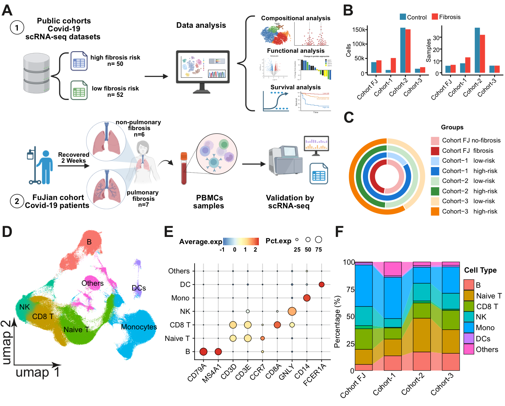
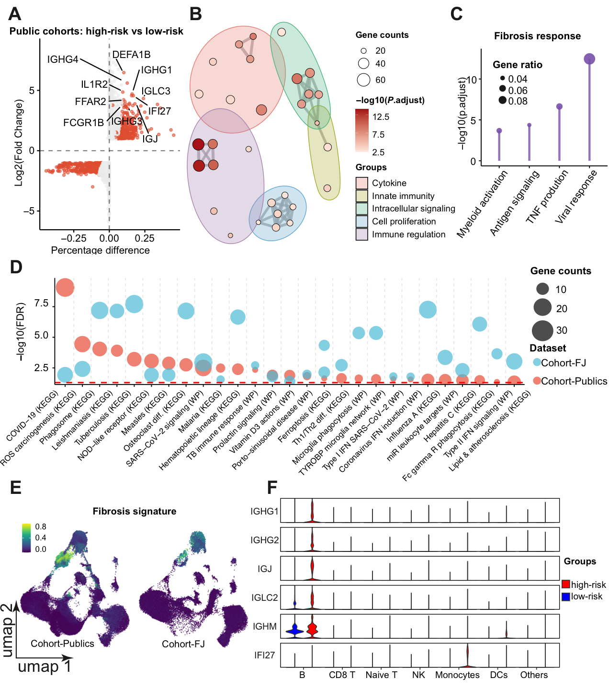
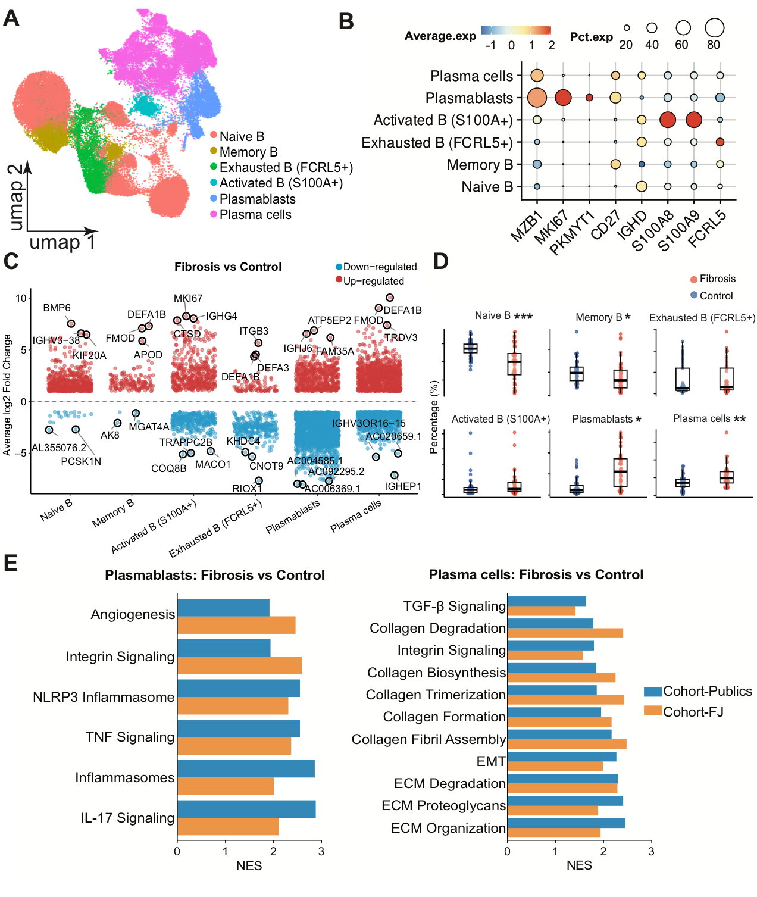
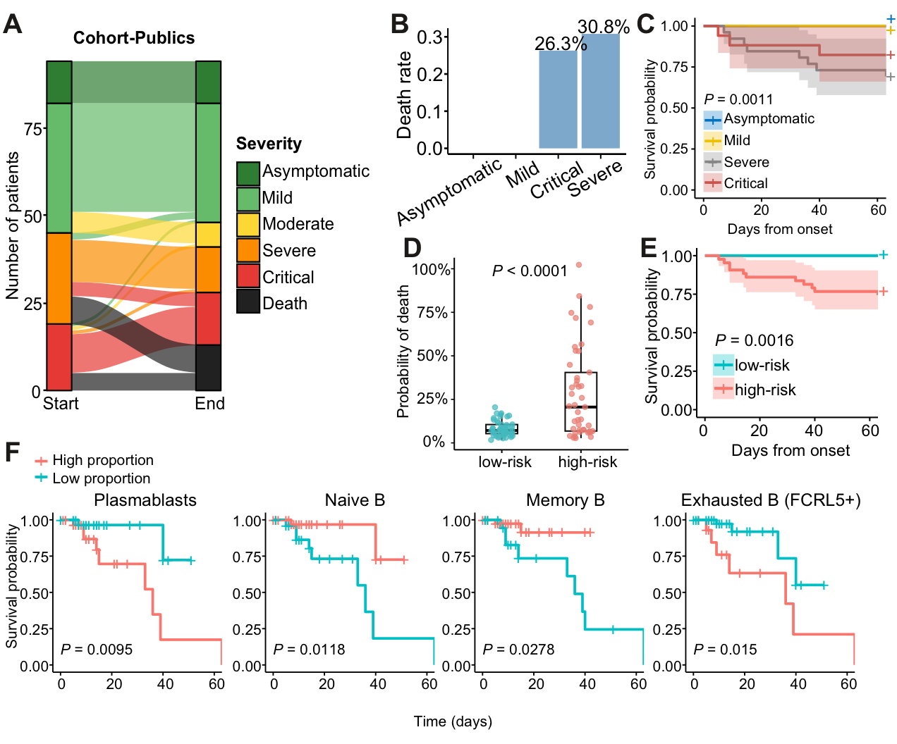

# Peripheral B cell dysregulation in post-COVID-19 pulmonary fibrosis

**Multi-cohort single-cell RNA-seq of patient blood (115 samples)**

Published in *Journal of Translational Medicine* (2026) · [doi:10.1186/s12967-026-08885-6](https://doi.org/10.1186/s12967-026-08885-6) · open access

**Wei Hang** (first author, co-first with S. Wu, H. Lin and Y. Wu) · Cardiff University and Fujian Provincial Hospital

---

## The question

Pulmonary fibrosis affects an estimated 10–30% of COVID-19 survivors and is often irreversible. Most studies look at lung tissue, which needs an invasive biopsy. We asked whether **a blood sample** shows immune changes that mark patients at high risk of fibrosis.

## What I did

- **Integrated single-cell RNA-seq from 115 PBMC samples**: 102 from three public cohorts, split into high (n = 50) and low (n = 52) fibrosis risk by disease severity, plus 13 patients from an in-house Fujian cohort with CT-confirmed fibrosis (n = 7) or no fibrosis (n = 6).
- **Quality control and integration**: cell filtering (200–6,000 genes, <25% mitochondrial reads), doublet removal (Scrublet) and batch correction across datasets and patients (Harmony).
- **Cell typing and B cell sub-clustering**: naive, memory, exhausted, activated B cells, plasmablasts and plasma cells.
- **Differential expression and pathway analysis**, compared between the public cohorts and the Fujian cohort.
- **Clinical outcome analysis**: linking B cell subset proportions to disease course and survival (Kaplan–Meier, log-rank).

## Key findings

1. Patients at high fibrosis risk lose **naive B cells** and gain **activated B cells, plasmablasts and plasma cells** in their blood.
2. **Plasma cells** in these patients are enriched for TGF-β signalling, collagen metabolism and extracellular-matrix remodelling, the core pathways of fibrosis.
3. **Plasmablasts** are enriched for inflammasome, TNF and angiogenesis pathways.
4. The expanded B cell subsets were each associated with **higher mortality**, and the high fibrosis-risk group had worse short-term survival (P < 0.001).
5. Similar B cell signals appeared in the independent, CT-confirmed Fujian cohort.

## Figures

**Figure 1. Study design and immune cell atlas across four cohorts.**

**Figure 2. Immunoglobulin and inflammatory genes up in high fibrosis-risk patients, and a B cell "fibrosis signature".**

**Figure 3. B cell subset changes in fibrosis.**

**Figure 4. Clinical outcomes and B cell subsets linked to mortality.**

## Methods at a glance

| Step | Tools |
|---|---|
| Alignment and counting (in-house cohort) | Cell Ranger 7.0, GRCh38 |
| QC, normalisation, clustering | Seurat 5 in R |
| Doublet removal | Scrublet |
| Batch integration | Harmony (dataset and patient ID as covariates) |
| Differential expression | Wilcoxon rank-sum test (Seurat) |
| Pathway enrichment | fgsea with MSigDB Hallmark, KEGG and WikiPathways gene sets |
| Survival analysis | Kaplan–Meier, log-rank test |

## Citation

> Hang W, Wu S, Lin H, Wu Y, et al. Peripheral B cell dysregulation associated with post-COVID-19 pulmonary fibrosis characterized by multi-cohort single-cell transcriptomics. *Journal of Translational Medicine* (2026). https://doi.org/10.1186/s12967-026-08885-6

Figures are reproduced unchanged from the published open-access article (CC BY-NC-ND 4.0), © the authors.

## Author

**Wei Hang**, PhD · [GitHub @hvgogogo](https://github.com/hvgogogo) · [ORCID 0009-0009-3954-1123](https://orcid.org/0009-0009-3954-1123)
